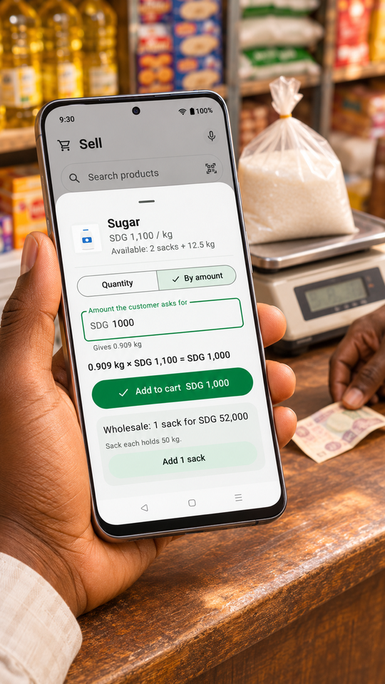
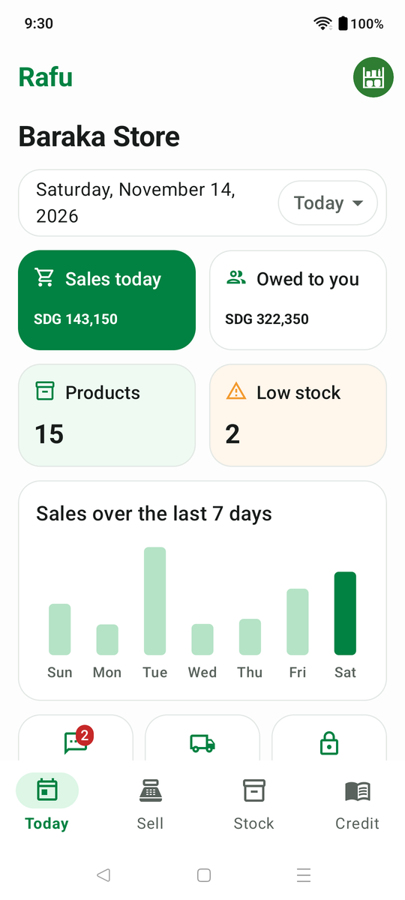
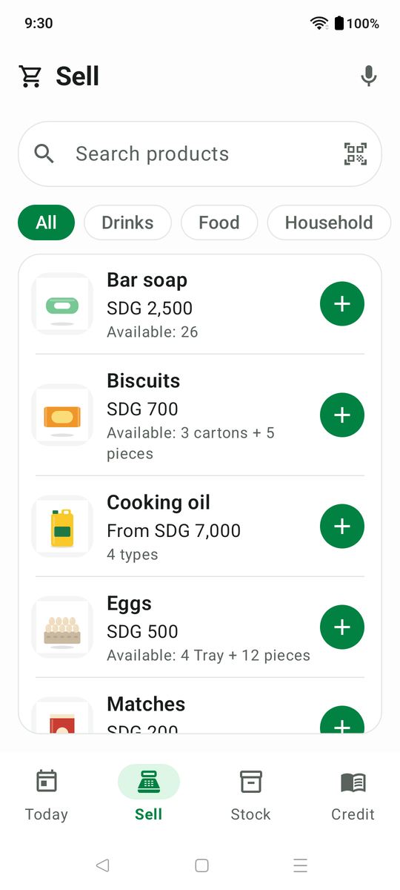
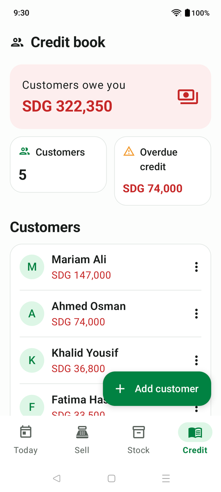
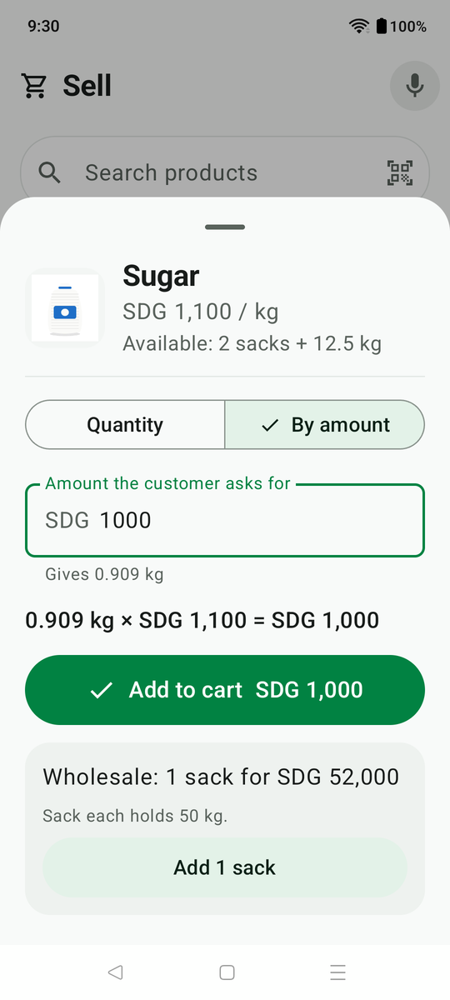
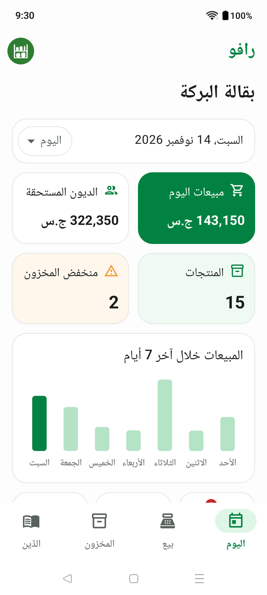
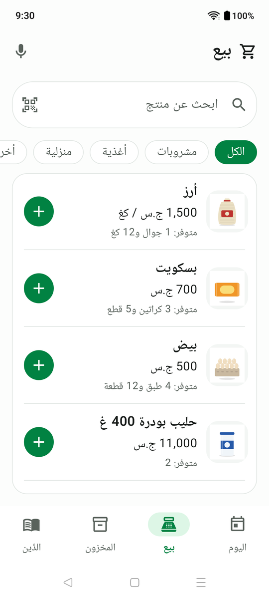
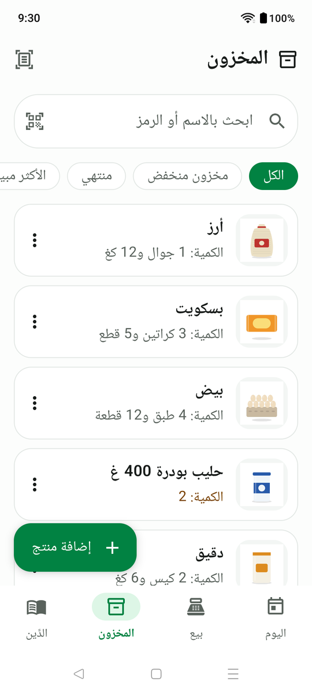
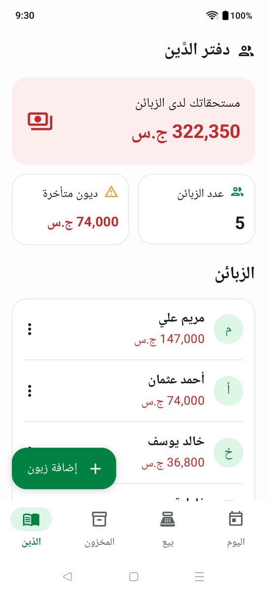
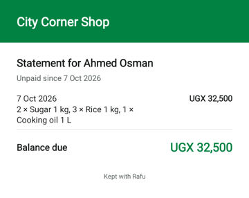

# Rafu

**An offline-first stock and sales book for small shops, with mobile-money reconciliation built in.**

*Rafu* is Swahili for "shelf". The app runs entirely on the phone, in English, Kiswahili, French and
Arabic.

---

## The problem

Across emerging markets, kiosks, small pharmacies and hardware stores still keep stock in a
notebook. Two things make that hard:

- **Stock drifts.** Quantities are crossed out and rewritten; nobody can say why the shelf count and
  the book disagree.
- **Mobile-money payments are hard to reconcile.** A customer pays by MTN MoMo, Airtel Money,
  M-Pesa or a bank app, the owner gets a text, and at the end of the day there is no reliable way to
  tell which sale each message paid for, or which "paid by phone" sale never actually arrived.

Rafu treats both as bookkeeping problems: every quantity change is a ledger entry, and every
mobile-money sale stays open until a real payment message is matched to it.

## Features

- **Products**: photo (camera or gallery, stored as a small private copy), name, price, quantity,
  category, barcode, buy price and low-stock alert.
- **Your categories**: a new shop is asked once what it sells (grocery, phones and electronics,
  pharmacy and cosmetics, hardware, clothing and shoes, other) and starts with categories that fit.
  Rename, delete, reorder and give them an icon and colour, from Settings or the product form.
  Search by name or scanned barcode; filters for low stock, out of stock, best-selling and archived.
- **Weights, packs and types**: sell by the piece, kilo, litre or metre with exact quantities
  (stored as thousandths of a unit, never floating point). Products bought in bulk record their pack
  (carton, sack, box, dozen or your own word), so stock reads "3 cartons + 5 pieces", restocks can
  be entered in packs and a whole pack can be sold at a wholesale price. A live profit calculator
  in the product form turns a sack price into a cost per kilo, converts between profit % and sell
  price and rounds to prices people pay with. Sizes and brands of one thing (cooking oil 1 L, 3 L,
  20 L) group under one product when selling.
- **Stock ledger**: every change is a movement (restock, sale, adjustment, return, write-off) written in the
  same transaction as the quantity, with a full history per product. Counting the shelf records
  the difference as an adjustment.
- **Expiry dates and true cost**: products that carry a date ("Has expiry dates") are received in
  batches by date (typed, picked or read from a photo of the pack), sold first-expiring-first, and
  noted calmly on Today before they expire, with an Expiring soon list to write off, sell at a
  discount or ignore. A restock at a new buying price moves the cost to the average of the shelf.
  Each product can say where it sits and, in a pharmacy, its active ingredient, which search finds.
- **Sell**: browse by category or scan a barcode, add with one tap or choose a quantity, weigh out
  ¼, ½ or 1 kg, or sell by amount ("sugar for 1,000" gives 1.111 kg at exactly 1,000), then check
  out with cash, mobile money or credit. Completing a sale writes the sale, its lines and the stock
  movements atomically; short stock cancels the whole sale.
- **Payment matching** (the signature feature): share a payment SMS to Rafu from your messages app,
  or paste it. Rafu reads the provider, amount, sender (phone masked), transaction id and time, and
  proposes the open sales with exactly that amount close in time. You confirm the match.
  Understands MTN MoMo, Airtel Money and M-Pesa style messages in English, and bank-app and
  mobile-wallet notifications in Arabic, including Arabic-Indic digits. Rejects outgoing,
  failed, PIN/OTP and promotional messages, and never stores the message text.
- **Today**: sales for today, this week or this month; real profit for the same period (profit on
  goods less expenses and write-offs); outstanding credit; product and low-stock counts; a
  seven-day sales chart; payments waiting to be matched; a quiet note when a supplier is due.
- **Price changes and split payment**: tap a cart line to agree a new price or take an amount off;
  the receipt shows the usual and the final price, and profit uses what was really paid. A sale can
  be paid part in cash, part by mobile money and the rest on credit, and a cash sale shows the
  change to give.
- **Returns and exchanges**: from the sales history, take back some or all of a sale. Stock
  returns with a ledger movement, cash or mobile money goes back or the customer's credit goes
  down; an exchange writes the return and the new sale together, linked.
- **Expenses, write-offs and reports**: rent, transport, electricity and your own kinds of
  expense; damaged or expired goods written off at cost with a reason. A Reports screen compares
  this month with last month (sales, profit, expenses, losses, real profit) and lists best sellers
  and slow movers.
- **Supplier credit**: what the shop owes each supplier, due dates and part payments.
- **Phone and electronics shops**: track a product by serial number or IMEI (with a Luhn check
  that gently flags a mistyped IMEI). Stock arrives with the serials of the units received, a sale
  picks the exact unit (search or scan), and the receipt shows the serial and the warranty end.
  Search any serial to see who bought it, returns and repairs, and its warranty. Repair job tickets
  with deposits, parts from stock, statuses and a WhatsApp "ready" message; trade-ins of used
  phones; sales on installments built on the credit book; and "sold together" sets such as a
  phone with its cover and screen protector. None of this shows in other shops.
- **Credit book**: total owed, overdue credit (unpaid for more than 30 days), every customer with
  what they owe. Add customers, start a credit sale for one, and record full or part payments,
  which settle the oldest sales first.
- **Debt reminders on WhatsApp**: one tap sends a polite reminder in the app language with a
  statement image (shop name, open sales, balance, date unpaid since). After a sale, share a
  receipt image the same way. WhatsApp opens directly when installed, otherwise the share sheet;
  no messaging API and no internet permission.
- **Receipt printer**: pair a 58 mm or 80 mm Bluetooth thermal printer in the phone's settings,
  choose it in Rafu and print sale receipts, repair tickets and debt statements, by hand or after
  every sale. The receipt is drawn on the phone and sent as an ESC/POS raster image, so Arabic
  prints correctly on printers without an Arabic code page.
- **Sell by voice**: say "two sugar and one cooking oil", "اثنين سكر وواحد زيت",
  "sukari mbili na mafuta moja" or "deux sucres et une huile". The phone's recognizer (offline
  where available) turns speech into text and Rafu's own parser matches it to your products,
  then shows what it understood before anything enters the cart.
- **Reorder**: what will run out within 1, 3 or 7 days at the pace of the last 14 days, with
  suggested quantities, sent to your supplier as a message.
- **Close the day**: expected cash (cash taken plus debt paid today, less refunds, expenses and
  supplier payments from the drawer) against the cash you count; the difference is kept in a
  day-by-day history.
- **Shops with staff** (off until the owner turns it on): the owner and staff on one phone, each
  with a 4-digit PIN (stored only as a salted hash, with growing waits after wrong tries). Roles
  (Seller, Stock keeper, everything) with per-permission switches; screens and buttons a person may
  not use are not shown. Every sale, payment, stock change, price change, expense and repair records
  who made it, listed on an Activity screen by day and person. Sellers open and close shifts with a
  float and a cash count; Close the day shows each person's sales, cash, mobile money, refunds and
  difference, and Today carries calm notes for large discounts, many returns or a short drawer.
  Receipts can say who served the customer.
- **Several phones in one shop** (nothing changes until the owner adds a phone): the owner's phone
  keeps the book; another phone joins by scanning a QR code and opening the shop file the owner
  sends, then sells too. Changes travel as an encrypted file (Nearby Share, Bluetooth, a cable, a
  message to yourself), still with no internet permission: opening it adds the other phone's
  sales, payments and stock changes once, and stock, sales and debts add up on both phones.
- **Quick access**: Quick Settings tiles (New sale, Match payment), app shortcuts (New sale, Match
  payment, Add expense, Close the day) and a home-screen widget with today's sales, what customers
  owe and a New sale button. All respect the person picker when People is on.
- **Backup and restore**: one zip file with every record and photo, saved wherever you choose.
  Restores are checked (format version, references, and the stock ledger) before anything is
  replaced.
- **Restock from receipt**: photograph a supplier receipt; on-device text recognition lists the
  lines and you pick which to add to stock.
- **Settings**: shop name, currency (UGX, KES, TZS, RWF, NGN, GHS, SDG, EGP, USD), language.
- **Languages**: English, Kiswahili, Français, العربية, with full right-to-left layout.
- **Demo shops** (debug builds only): one tap in Settings fills the app with sample products,
  pictures, a week of sales and a few credit customers, plus a seller and a stock keeper with
  attributed sales and a closed shift (demo PINs: owner 1234, seller 1111, stock keeper 2222); or
  with a phone shop: phones by IMEI, accessories, two repairs and an installment sale.

## Screenshots

  
  
  
  

Right to left, in Arabic:

  
  
  
  

A debt statement, shared to WhatsApp in one tap:

## Built with

Kotlin, Jetpack Compose and Material 3, Room, Hilt, coroutines, and on-device ML Kit text
recognition. Offline-first: no account, no server, no analytics.

## Technical report

How Rafu works inside, from payment-message matching to phone-to-phone sync:
Ahmed, S. (2026). *Rafu: An Offline-First Ledger for Small Shops with Privacy-Preserving Mobile-Money
Reconciliation.* Technical report. Zenodo. [doi.org/10.5281/zenodo.24293289](https://doi.org/10.5281/zenodo.24293289)

## Privacy

- Everything stays on the device. There is no account, no server and no analytics.
- Rafu does **not** request `READ_SMS` or `RECEIVE_SMS`. It only sees a message when you share or
  paste it, and it stores the extracted fields, never the message text.
- Sender phone numbers are masked before they are stored.
- Receipt text recognition runs on the device. Barcode scanning uses the Google Play services
  scanner, so Rafu needs no camera permission.
- The microphone is requested only when you tap the voice-sale button; Rafu receives text, not audio.
- Backups are files you create and keep; Rafu uploads nothing.
- Files for the shop's other phones are encrypted (AES-256-GCM) with a key only the two phones
  share, given by a QR code; Rafu sends nothing itself, the owner moves the file.

The full policy is in [`docs/privacy/`](docs/privacy/index.html) ([Arabic](docs/privacy/ar.html)).
- Records are excluded from cloud backup. On Android 12 and later, a direct phone-to-phone
  transfer can still carry them to the owner's new phone.

## Origin

In 2022 I was a Google Africa Developer Scholarship (GADS) scholar on the Associate Android
Developer track, with Andela and Pluralsight. One of the codelabs was a small
[inventory app](https://github.com/Saifuddin2Ahmed/android-basics-kotlin-inventory-app) that
taught me Room. Rafu is what that lesson became: a real tool for the shops around me.

  

Google Africa Developer Training Program, Certificate of Course Completion in Android
Development (six months), issued 16 March 2023, certificate ID C3357B220EBAA41.
More about me on [LinkedIn](https://www.linkedin.com/in/saifuddin2ahmed/).

## Get Rafu and work with me

Rafu is in testing on Google Play. Shops, cooperatives and organizations that support small
businesses can ask for early access, a pilot, or a partnership through
[saifuddin.dev](https://saifuddin.dev).

## Source code

This repository is the public home of Rafu: its story, screenshots and privacy policy. The source
code is kept private and is shared with partners on request.

Copyright 2026 Saifuddin Ahmed. All rights reserved.
